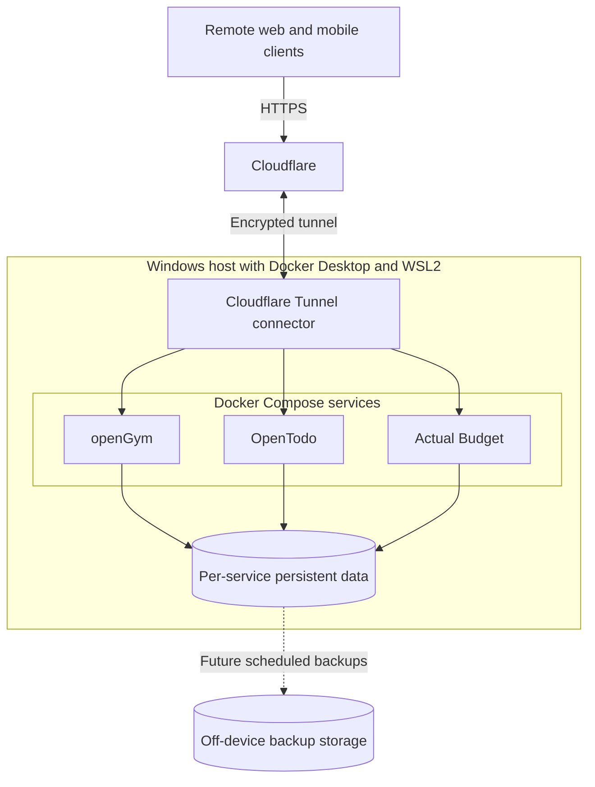

# Homelab

A self-hosting infrastructure project built around Docker Compose. The goal is to deploy and maintain a small set of applications from version-controlled configuration and recover them on another host from tested backups.

## Services

| Service | Purpose |
| --- | --- |
| openGym | Workout tracking and training routines |
| OpenTodo | Shared task management |
| [Actual Budget](compose/actualbudget/README.md) | Budgeting and financial tracking |

## Planned architecture

## Deployment approach

- Prepare the Windows host with Docker Desktop and WSL2, then validate services locally. See the [host setup and Compose guide](compose/README.md).
- Use Cloudflare Tunnel for services that need remote HTTPS access without router port forwarding. Verify sign-in and synchronization from supported clients.
- Track Compose files, environment variable templates, and runbooks in Git. Keep credentials, application data, and backups outside the repository.
- Document how to verify and roll back updates. Automated off-device backups and a full rebuild test are planned for later.
